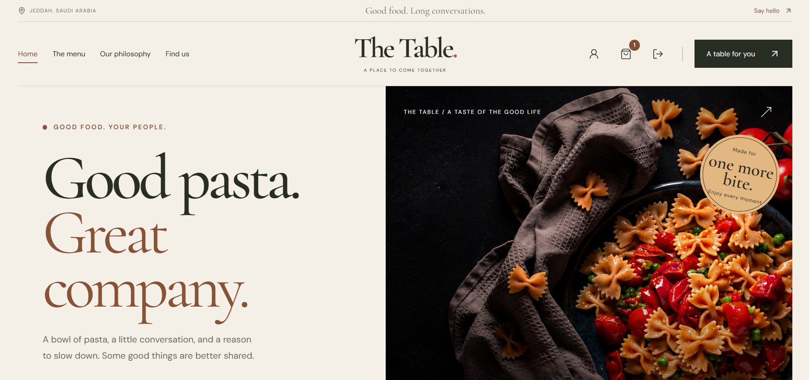

# The Table

**A full-stack restaurant ordering and operations platform.**

The Table combines a customer storefront, online payments, reservations, table QR ordering, cashier and kitchen workspaces, restaurant-managed delivery, staff access management, and notifications. A warm editorial interface connects customers and staff to an Express API and MongoDB.

[Customer website](https://the-table-khaki.vercel.app/) · [API health](https://thetable-50sf.onrender.com/health) · [Screenshots](#screenshots) · [Local setup](#local-setup) · [Deployment](#deployment)

The public links identify this project's services. Availability and enabled integrations depend on the deployed version and configuration.

## Contents

- [Features](#features)
- [Screenshots](#screenshots)
- [Technology and design](#technology-and-design)
- [Project structure](#project-structure)
- [Roles and routes](#roles-and-routes)
- [Restaurant workflows](#restaurant-workflows)
- [Local setup](#local-setup)
- [Environment configuration](#environment-configuration)
- [Restaurant setup](#restaurant-setup)
- [Notifications](#notifications)
- [API overview](#api-overview)
- [Deployment](#deployment)
- [Development and verification](#development-and-verification)
- [Security and limitations](#security-and-limitations)
- [Troubleshooting](#troubleshooting)
- [Detailed guides](#detailed-guides)

## Features

### Customer experience

- Responsive homepage with four hero slides, featured dishes, and editable content.
- Our Philosophy/About page, menu, and restaurant location pages.
- Dish-detail dialogs and menu options.
- Shared cart with quantity controls, totals, browser persistence, and signed-in account separation.
- Delivery, pickup, and table-based dine-in checkout.
- Saudi mobile validation and normalization.
- Service-area, schedule, fee, minimum-order, and availability checks.
- Stripe-hosted Checkout with backend payment verification.
- Protected account with orders, reservations, history, and notification preferences.
- Driver contact links and recipient handoff codes.
- Optional transactional email and SMS updates.

### Restaurant operations

- Admin overview, menu management, and MongoDB-backed website content editing.
- Location, hours, fulfillment, tax, and workflow settings.
- Cashier, kitchen, and driver access using verified accounts.
- Cashier acceptance/rejection, ready-time estimates, dispatch, and handoff.
- Kitchen queue with start/finish preparation actions.
- Staff reservation desk.
- Driver workspace with assignments, directions, contact, progress, issues, and handoff verification.
- Tables with QR generation, download, print, disabling, and token replacement.
- Background driver push alerts and acknowledgement monitoring.
- Independent email/SMS administration, explicit tests, and activity logs.

## Screenshots

Existing images from [client/src/assets/The Table](client/src/assets/The%20Table) show the captured interface. The running application may include later changes.

### Storefront

| Homepage | Our Philosophy |
| --- | --- |
|  |  |

| Menu | Contact |
| --- | --- |
|  |  |

### Shopping and customer account

| Cart | Customer dashboard |
| --- | --- |
|  |  |

| Delivery checkout | Pickup checkout |
| --- | --- |
|  |  |

### Staff workspaces

| Cashier desk | Kitchen display |
| --- | --- |
|  |  |

| Driver dashboard |
| --- |
|  |

### Administration

| Admin overview | Staff and driver access |
| --- | --- |
|  |  |

| Location and fulfillment | Operations settings |
| --- | --- |
|  |  |

## Technology and design

| Layer | Implementation |
| --- | --- |
| Frontend | React 19, Vite 8, TypeScript, React Router |
| Styling | Pure CSS in client/src/styles; no Tailwind |
| Authentication | Clerk React and Express integrations |
| Backend | Express 5 and TypeScript, compiled to JavaScript |
| Database | MongoDB and Mongoose |
| Validation | Zod and server-side workflow checks |
| Payments | Stripe-hosted Checkout and signed webhooks |
| Email | Nodemailer/Gmail SMTP; optional Resend HTTPS |
| SMS | Infobip or Android/SIM gateway |
| Driver push | Web Push, VAPID, service worker, persistent jobs |
| QR | qrcode; jsQR for decoding checks |
| Verification | TypeScript, ESLint, Playwright fixtures, backend flow scripts |

DM Sans is used for body text and Cormorant Garamond for headings.

| Token | Color |
| --- | --- |
| Canvas | #F5F0E7 |
| Olive | #292E24 |
| Terracotta | #A26748 |
| Sandstone | #D9C9B6 |

Prices are calculated on the server in integer halalas and displayed in SAR. Schedules and operational dates use Saudi time where applicable.

## Project structure

~~~text
.
├── client/
│   ├── public/              Public assets, manifest and service worker
│   ├── scripts/             Browser/UI verification
│   ├── src/
│   │   ├── app/             App shell and router
│   │   ├── assets/          Images, HeroPage.png and screenshots
│   │   ├── components/      Shared UI, authentication and forms
│   │   ├── config/          Frontend configuration
│   │   ├── context/         Cart and table-session providers
│   │   ├── hooks/           Cart, auth and API hooks
│   │   ├── lib/             API client, types and utilities
│   │   ├── pages/           Customer, admin and staff pages
│   │   └── styles/          Pure CSS
│   └── vercel.json          SPA deployment configuration
├── server/
│   ├── scripts/             Backend verification
│   └── src/
│       ├── config/          Environment, database and provider setup
│       ├── data/            Menu/content defaults
│       ├── middleware/      Authentication, permissions and validation
│       ├── modules/         Feature APIs, models and services
│       ├── scripts/         Explicit setup and worker commands
│       ├── app.ts           Express middleware and routes
│       └── server.ts        Database, workers and listener
├── render.yaml              Optional Render Blueprint
└── *.md                     Setup and operations guides
~~~

Backend modules cover content, delivery, email, fulfillment, menu, operations, orders, payments, push, reservations, SMS, tables, team, users, and webhooks. Client and server have separate package manifests.

## Roles and routes

The backend verifies identity, permissions, and ownership independently of frontend navigation.

| Audience | Routes | Purpose |
| --- | --- | --- |
| Public | /, /about, /menu, /locations | Discovery and menu |
| Public entry | /table/:token | Resolve a QR table link |
| Authentication | /login/*, /signup/* | Clerk and OAuth callbacks |
| Shopping | /cart, /checkout | Cart and fulfillment-aware checkout |
| Customer | /account, /account/orders/:id | Profile, orders, driver contact and code |
| Customer | /reservations, /account/reservations/:id | Reservation requests/details |
| Admin | /admin | Overview |
| Admin | /admin/menu, /admin/content | Menu and website content |
| Admin | /admin/orders, /admin/orders/:id | Order administration |
| Admin | /admin/team | Staff access |
| Admin | /admin/fulfillment, /admin/operations | Restaurant settings |
| Admin | /admin/tables | Tables and QR codes |
| Admin | /admin/email, /admin/sms | Notifications |
| Admin | /admin/reservations | Reservation desk |
| Admin/cashier | /cashier, /cashier/orders/:id, /cashier/reservations | Orders and reservations |
| Admin/kitchen | /kitchen | Preparation queue |
| Driver | /driver | Assigned deliveries |

The router also includes /contact and /privacy through shared RoutePage/StarterPage components. Confirm their published content before launch.

Administrators are protected from ordinary staff removal. Drivers need verified accounts and Saudi work mobiles. Active deliveries restrict changes to assigned-driver access.

## Restaurant workflows

### Ordering and payment

1. The customer adds dishes to the shared cart.
2. Checkout collects delivery, pickup, or selected-table information.
3. The API validates current items/options, prices, schedules, service areas, minimums, fees, and operational readiness.
4. The saved order starts unpaid, and the customer continues to Stripe-hosted Checkout.
5. A supported signed webhook verifies payment and moves an eligible order to pending restaurant confirmation.
6. Cashier staff accept or reject it; payment alone does not mean restaurant acceptance.
7. Kitchen staff start preparation and mark the food ready.
8. Staff complete pickup, table service, or the delivery handoff.

Frontend redirects cannot mark orders paid. Cancelling an order does not automatically issue a refund.

### Restaurant-managed delivery

1. The cashier dispatches a paid, ready order to a registered driver.
2. The driver opens /driver and acknowledges the assignment.
3. The driver records collection and follows the saved address/coordinates.
4. The driver records arrival and contacts the customer through call/WhatsApp links.
5. After receiving the food, the customer shares the six-digit code from their account.
6. The driver submits that code to record completion.

Incorrect-code attempts are limited. Delivery issues can be reported for restaurant review. Progress describes recorded actions; live GPS tracking is not implemented. Push/email alerts do not replace cashier assignment or physical delivery.

### Dine-in and QR ordering

1. Create actual tables in /admin/tables.
2. Download/print each QR image and place it on the matching table.
3. Scanning opens the public website at /table/:token.
4. The API resolves the table, and its selection carries into menu/cart/checkout.
5. The order displays its table label to cashier and kitchen.
6. Staff record service through the dine-in completion action.

VITE_PUBLIC_SITE_URL is the public customer website origin. VITE_API_URL is the backend API address. The public website and admin must use the same restaurant database.

Printed codes keep their original URL. Download and replace them after changing the website address. Replacing a table token invalidates the old link. A QR identifies a table but does not prove physical presence.

### Reservations

Customers submit requests using the configured schedule and party limits. Staff confirm/cancel them and record completion for actual visits. Customer details/history remain account-scoped.

A reservation request is not confirmed seating. Automated seating-capacity allocation is not included.

## Local setup

### Prerequisites

- Node.js 24.x, matching the frontend engine and deployment configuration.
- npm and MongoDB/Atlas access.
- A Clerk application with matching frontend/backend keys.
- Stripe credentials and webhook setup for paid ordering.
- Optional email, SMS, and VAPID credentials.

### Install

From the repository root:

~~~sh
npm ci --prefix server
npm ci --prefix client
~~~

Use [client/.env.example](client/.env.example) and [server/.env.example](server/.env.example) as references. Create local configuration only when needed; preserve existing credentials.

Vite reads general and mode-specific files, including client/.env.local and client/.env.development.local. Mode-specific local values can override general values. Restart after changes.

### Start

Terminal 1:

~~~sh
npm run --prefix server dev
~~~

Terminal 2:

~~~sh
npm run --prefix client dev
~~~

| Service | Default local address |
| --- | --- |
| Frontend | http://localhost:5173 |
| Backend health | http://localhost:4000/health |
| API | http://localhost:4000/api/v1 |

The backend connects to MongoDB and initializes collections/indexes before listening. A healthy API does not prove external payment or notification delivery.

## Environment configuration

Keep real environment files untracked. Server secrets must never appear in VITE_ variables, screenshots, or logs.

### Frontend: public values

~~~env
VITE_API_URL=http://localhost:4000/api/v1
VITE_CLERK_PUBLISHABLE_KEY=YOUR_CLERK_PUBLISHABLE_KEY
VITE_PUBLIC_SITE_URL=https://the-table-khaki.vercel.app
~~~

| Variable | Purpose |
| --- | --- |
| VITE_API_URL | Backend origin plus /api/v1 |
| VITE_CLERK_PUBLISHABLE_KEY | Public key from the matching Clerk application |
| VITE_PUBLIC_SITE_URL | Customer website origin embedded in printed table QR codes |
| VITE_STRIPE_PUBLISHABLE_KEY | Optional public Stripe key; sessions are created by the server |

Vite embeds public settings at build time. Redeploy Vercel after changes.

### Backend: core settings

| Variable | Purpose/default behavior |
| --- | --- |
| NODE_ENV | development locally; production on the host |
| PORT | Defaults to 4000 locally; Render supplies its own port |
| MONGODB_URI | Required private database connection |
| MONGODB_DB_NAME | Explicit database selection; this project uses thetable |
| CLERK_SECRET_KEY | Required private Clerk key |
| CLERK_PUBLISHABLE_KEY | Required for authenticated APIs; validated at production startup |
| CLERK_WEBHOOK_SECRET | Clerk webhook signing secret |
| CLIENT_ORIGINS | Comma-separated exact browser origins; no paths, wildcards, or trailing slash |
| STRIPE_SECRET_KEY | Private Stripe API key |
| STRIPE_WEBHOOK_SECRET | Deployed Stripe endpoint signing secret |
| ORDER_CREATION_ENABLED | Defaults false; true still requires payment/restaurant readiness |
| RESERVATION_CREATION_ENABLED | Defaults false; reservation settings must also be valid |
| ADMIN_EMAIL | Intended protected admin identity; does not automatically grant a role on login |
| MONGODB_DNS_SERVERS | Optional diagnostic resolver override |

Missing optional integrations disable their features without necessarily stopping API health. Invalid nonempty settings can still fail startup. An empty production origin list blocks browser/authenticated access.

### Gmail email

~~~env
EMAIL_PROVIDER=gmail
EMAIL_MODE=production
EMAIL_ENABLED=true
GMAIL_USER=YOUR_SENDING_ACCOUNT@gmail.com
GMAIL_APP_PASSWORD=YOUR_GOOGLE_APP_PASSWORD
EMAIL_FRONTEND_URL=http://localhost:5173
EMAIL_DAILY_LIMIT=50
~~~

Nodemailer connects to smtp.gmail.com:465 using TLS. Enable Google 2-Step Verification and create an App Password; do not use the normal account password.

For restricted testing, use EMAIL_MODE=demo with EMAIL_TEST_RECIPIENT matching the verified signed-in test address. Production mode does not need a test recipient. EMAIL_FRONTEND_URL must be the actual HTTPS customer website origin in production.

### Optional integrations

| Integration | Variables |
| --- | --- |
| Resend | EMAIL_PROVIDER=resend, RESEND_API_KEY, RESEND_FROM, shared EMAIL_* settings |
| Resend demo | EMAIL_MODE=demo, EMAIL_TEST_RECIPIENT matching the Resend account email; sender onboarding@resend.dev |
| Infobip | SMS_PROVIDER=infobip, INFOBIP_BASE_URL, API_KEY or INFOBIP_API_KEY, INFOBIP_SENDER |
| Android/SIM SMS | SMS_PROVIDER=android, SMS_GATEWAY_DEVICE_ID, SMS_GATEWAY_TOKEN or SMS_GATEWAY_USERNAME/SMS_GATEWAY_PASSWORD |
| SMS control | SMS_ENABLED, SMS_DAILY_LIMIT; Android also SMS_GATEWAY_SIM_NUMBER |
| Driver Web Push | VAPID_PUBLIC_KEY, VAPID_PRIVATE_KEY, WEB_PUSH_SUBJECT |
| Driver acknowledgement | DRIVER_ACK_TIMEOUT_SECONDS, default 120 |

For Infobip, API_KEY takes precedence over INFOBIP_API_KEY. Neither is a Gmail/Resend credential.

Email and SMS each have environment switches and separate restaurant switches stored in MongoDB. Credentials alone do not enable automatic notifications.

## Restaurant setup

For a new database/identity configuration:

1. Assign the initial administrator through the trusted setup process.
2. Configure the real address, schedule, fulfillment details, estimates, service areas, fees, minimum order, and operational settings.
3. Enable order/reservation creation after required settings are complete.
4. Add menu dishes through /admin/menu or explicitly import the existing dataset.
5. Add staff through /admin/team; employees complete Clerk sign-in themselves.
6. Create actual tables and print public QR links.
7. Configure notifications, enable the restaurant switch, and test real reception.
8. Customers/drivers opt into email from their dashboards.

Explicit setup commands, from the repository root:

| Command | Purpose |
| --- | --- |
| npm run --prefix server seed:menu -- --confirm-menu | Import existing menu data with insert-only slug upserts |
| npm run --prefix server setup:content | Backfill editable content defaults |
| npm run --prefix server setup:hero | Apply the existing hero-image mapping |
| npm run --prefix server setup:admin -- --confirm-admin | Assign the fixed intended administrator after identity checks |
| npm run --prefix server setup:service -- --confirm-service | Apply project-specific service settings; inspect before use |

These commands can modify the database or provider metadata. They are not needed on every startup. The menu dataset is project sample content. The service script contains restaurant-specific assumptions; configure another restaurant through the admin settings.

## Notifications

### Email

At /admin/email, inspect configuration, check Gmail authentication, enable sending, submit explicit tests, and view activity.

- Customers opt in at /account; drivers can opt in at /driver.
- Recipients come from verified account profiles, not arbitrary checkout addresses.
- Eligible customer events include verified payment pending acceptance, acceptance, preparation, readiness, dispatch, collection, arrival, completion, and cancellation/rejection.
- Reservation confirmation/cancellation can generate email.
- Assignment alerts go to the verified, opted-in assigned driver.
- Reassigned or already acknowledged driver alerts are suppressed.
- Emails link to protected customer/driver pages; codes and recipient addresses are not embedded.
- Unique event keys, atomic leases, expiry, and shared attempt limits control processing.
- Uncertain Gmail SMTP submissions are not automatically resent.
- Provider acceptance is not an independently verified inbox-delivery status.

The API checks notification work every 15 seconds while running. Only eligible recent events after activation/opt-in are considered; old orders are not bulk emailed.

### SMS

/admin/sms supports Infobip and Android/SIM gateways, customer consent, queued jobs, retry/reconciliation behavior, and provider tracking.

Infobip needs sending/log-reading permissions, an eligible sender, and account access/credit. An expired trial or provider 403 cannot be bypassed by application settings.

### Driver push

VAPID and device subscriptions support background alerts through a service worker and persistent jobs. Push payloads omit customer personal information and delivery codes.

Delivery depends on permission, connectivity, browser support, and a running worker. On supported iPhone/iPad versions, install the site on the Home Screen before enabling notifications. Acknowledgement warnings prompt restaurant follow-up; they do not guarantee the driver saw an alert.

## API overview

Routes are registered in server/src/app.ts and their feature modules.

| Prefix | Access and purpose |
| --- | --- |
| GET /health | Public database readiness |
| /api/v1/settings | Public restaurant/availability settings |
| /api/v1/menu | Public menu list/detail |
| /api/v1/content | Published website content |
| /api/v1/tables/:token | Public table resolution |
| /api/v1/users | Authenticated account profile |
| /api/v1/orders | Own orders, creation, detail, and payment-session action |
| /api/v1/reservations | Own reservation requests/details |
| /api/v1/notifications/email | Own email preferences |
| /api/v1/notifications/sms | Own SMS preferences |
| /api/v1/staff/orders | Cashier/admin order actions |
| /api/v1/staff/reservations | Staff reservation actions |
| /api/v1/kitchen/orders | Kitchen/admin preparation |
| /api/v1/driver/orders | Assigned-driver progress/handoff |
| /api/v1/driver/push | Authenticated driver subscriptions |
| /api/v1/admin/* | Administrative menu, content, team, tables, settings, and notifications |

Customer ownership is derived from verified Clerk authentication, not a browser-supplied user ID or email.

### Signed webhooks

| Method and path | Purpose |
| --- | --- |
| POST /api/webhooks/stripe | Stripe payment-event verification |
| POST /api/webhooks/clerk | Clerk identity-event verification |

These endpoints are outside /api/v1. Raw-body routes run before JSON parsing. Signature verification precedes trusted changes, and persistent event receipts deduplicate retries.

Stripe checks the saved session/order details. Supported events include checkout.session.completed and checkout.session.expired. A completed session must report paid before an order is marked paid.

## Deployment

### Vercel frontend

| Setting | Value |
| --- | --- |
| Root directory | client |
| Framework | Vite |
| Build command | npm run build |
| Output directory | dist |

client/vercel.json includes SPA rewrites for direct visits to routes such as /account and /table/:token.

Set the matching public Clerk key and frontend configuration:

~~~env
VITE_API_URL=https://thetable-50sf.onrender.com/api/v1
VITE_PUBLIC_SITE_URL=https://the-table-khaki.vercel.app
~~~

Configure Clerk origins/redirects for the deployed website. Environment changes need a new frontend build.

### Render backend

| Setting | Value |
| --- | --- |
| Runtime | Web Service / Node |
| Root directory | server |
| Build command | npm ci --include=dev && npm run build |
| Start command | npm start |
| Health-check path | /health |
| Node | 24 |

The server listens on 0.0.0.0 and the host's PORT. Set variables in Render Environment; do not upload server/.env. The root render.yaml is an optional initial Blueprint.

Actual webhook URLs for this project's current backend:

~~~text
https://thetable-50sf.onrender.com/api/webhooks/stripe
https://thetable-50sf.onrender.com/api/webhooks/clerk
~~~

Use secrets from the matching provider account/mode and endpoint. Configure CLIENT_ORIGINS with the exact Vercel origin and allow backend connectivity in MongoDB Atlas.

**Render Free blocks Gmail SMTP ports 465 and 587.** Use hosting that permits SMTP or an HTTPS email provider. A working local App Password does not remove a hosting port block. See [Render's free-service restrictions](https://render.com/docs/free).

Sleeping hosts delay polling and notification work. Push/SMS have standalone worker commands; email currently runs inside the API process. Timely notifications need appropriate always-on infrastructure.

## Development and verification

### Static checks and builds

~~~sh
npm run --prefix server typecheck
npm run --prefix server build
npm run --prefix client typecheck
npm run --prefix client lint
npm run --prefix client build
~~~

Start compiled backend code after building:

~~~sh
npm start --prefix server
~~~

No backend lint command is configured.

### Available checks

Run checks deliberately against a suitable development/test environment.

| Package | Scripts |
| --- | --- |
| Client basics | test:routes, test:responsive, test:menu, test:cart, test:checkout |
| Client workflows | test:flow, test:tables, test:reservations |
| Client notifications | test:push, test:sms |
| Server workflows | test:flow |
| Server notifications | test:push, test:sms, test:infobip, test:email |

Examples:

~~~sh
npm run --prefix client test:tables
npm run --prefix server test:email
~~~

Frontend flow checks use isolated Vite/auth/API/payment fixtures; QR checks decode the generated image. They do not complete real Clerk OAuth or charge Stripe cards.

Backend flow scripts may connect to MongoDB and create isolated test databases. Email verification replaces SMTP/HTTP sending with mocks. Passing mocks does not prove provider delivery.

Standalone workers, after building:

~~~sh
npm run --prefix server start:push-worker
npm run --prefix server start:sms-worker
~~~

Supplement automated checks with a real-device restaurant pilot covering sign-in, payment webhooks, cashier/kitchen handling, QR ordering, driver handoff, and actual notifications.

## Security and limitations

- Clerk handles passwords/sessions; MongoDB profiles do not store passwords.
- Server permissions scope customer records and assigned-driver deliveries.
- The API recalculates totals and validates order transitions.
- Signed Stripe events control paid status.
- Validation, rate limits, CORS, and Helmet are configured.
- Revision/timestamp checks protect sensitive updates from stale edits.
- Real environment files are ignored; verify they remain untracked in your repository.
- Content image editing accepts supported paths/URLs; media uploads are not included.
- Table tokens do not verify physical presence.
- POS hardware, receipt printers, cash drawers, payment terminals, external courier booking, and live driver GPS are not connected.
- Cancellation is separate from refunds/disputes; automated refund handling needs additional work.
- Reservations do not automatically allocate seating capacity.
- Backups, restore drills, monitoring, legal copy, hosting capacity, and staff procedures need deployment/operator setup.

This is an advanced restaurant MVP. Feature coverage does not guarantee uninterrupted production operation.

## Troubleshooting

| Symptom | Check |
| --- | --- |
| Unable to reach service | Backend health, VITE_API_URL, CLIENT_ORIGINS, and connectivity |
| Protected API unavailable | Matching Clerk keys, session, and allowed origins |
| Ordering unavailable | Opening hours, creation switches, fulfillment settings, service areas, and Stripe readiness |
| Saved order absent from kitchen | Payment verification and cashier acceptance |
| Driver sees no orders | Cashier assignment to the exact verified driver account |
| QR opens localhost | Set VITE_PUBLIC_SITE_URL, restart/redeploy, download and replace printed codes |
| Public QR cannot find table | Same API/database, enabled table, and current token |
| Email remains queued | Running worker, switches, limit, opt-in, and verified account email |
| Gmail timeout on Render | Free-service SMTP port restrictions |
| Email accepted | Check inbox/spam; provider acceptance is not inbox verification |
| SMS 403 | Provider permissions, account/credit, sender eligibility, and configured key |
| Reservation unavailable | Creation switch, hours, party limits, and a valid future time |

## Detailed guides

| Guide | Coverage |
| --- | --- |
| [Backend README](server/README.md) | API, authentication, configuration, deployment |
| [Frontend README](client/README.md) | Frontend setup, content, account, QR origins |
| [Table ordering](TABLE_ORDERING.md) | Tables and QR workflows |
| [Reservations](RESERVATIONS.md) | Customer requests and staff handling |
| [Delivery operations](DELIVERY_OPERATIONS.md) | Dispatch, progress, issues, handoff |
| [Email setup](EMAIL_SETUP.md) | Gmail, Resend, queue, preferences, hosting |
| [SMS setup](SMS_SETUP.md) | Android/SIM configuration |
| [Infobip setup](INFOBIP_SETUP.md) | API settings, scopes and sender troubleshooting |
| [Web Push setup](WEB_PUSH_SETUP.md) | Driver background alerts |
| [Workflow status](WORKFLOW_STATUS.md) | Recorded operational review |
| [System test report](SYSTEM_TEST_REPORT.md) | Recorded verification and limitations |

Some detailed guides contain earlier implementation notes. Refer to current source and package manifests for exact routes, defaults, scripts, and behavior.

